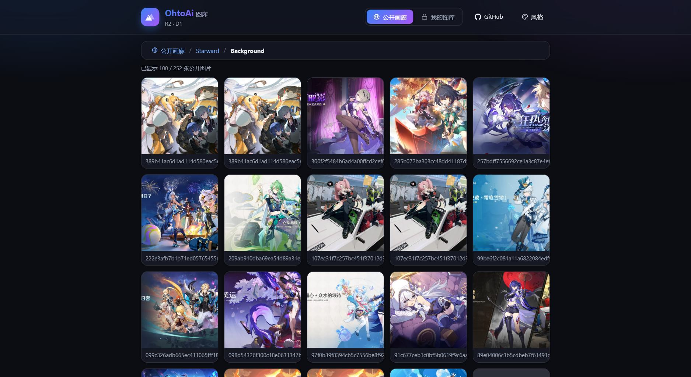
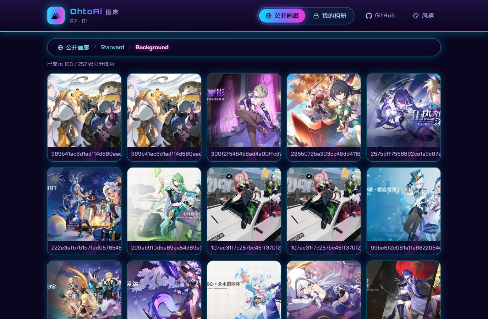
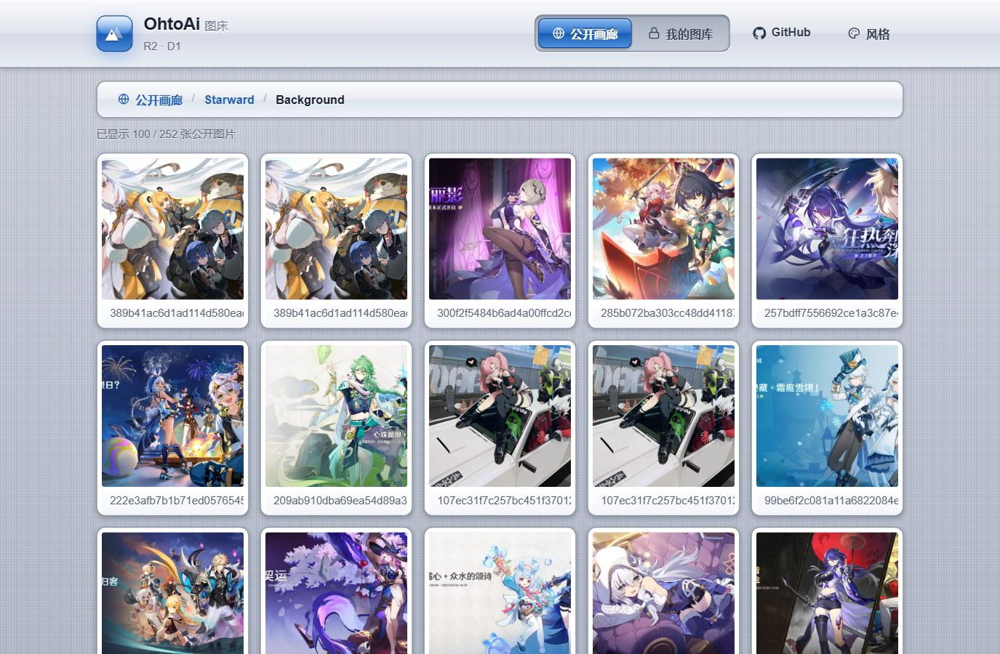
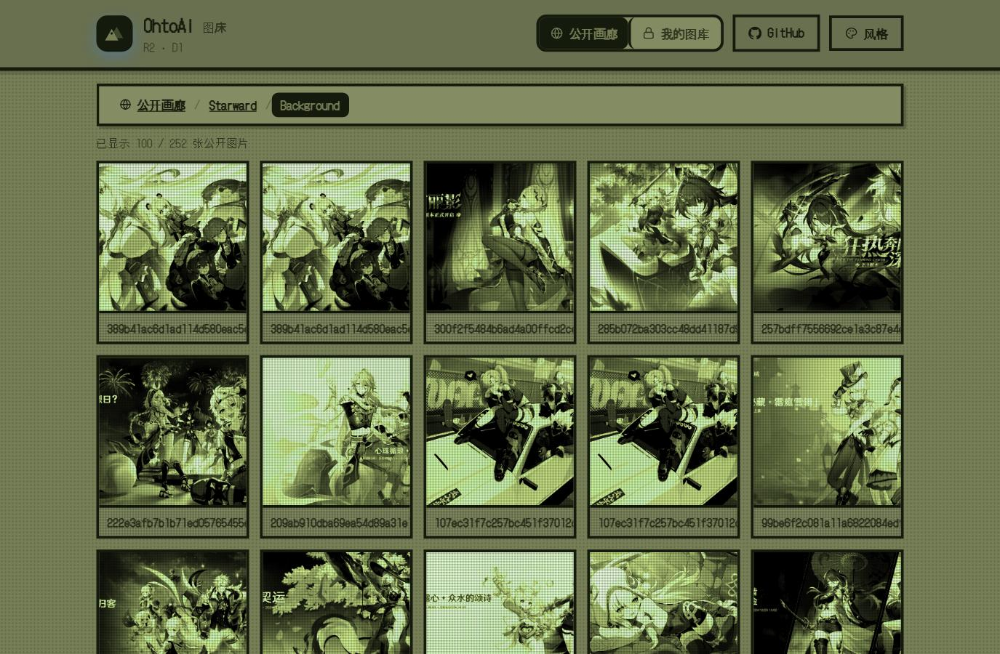
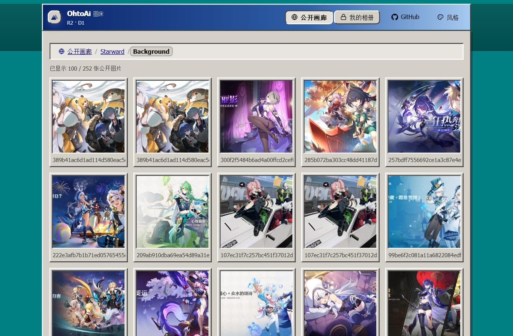
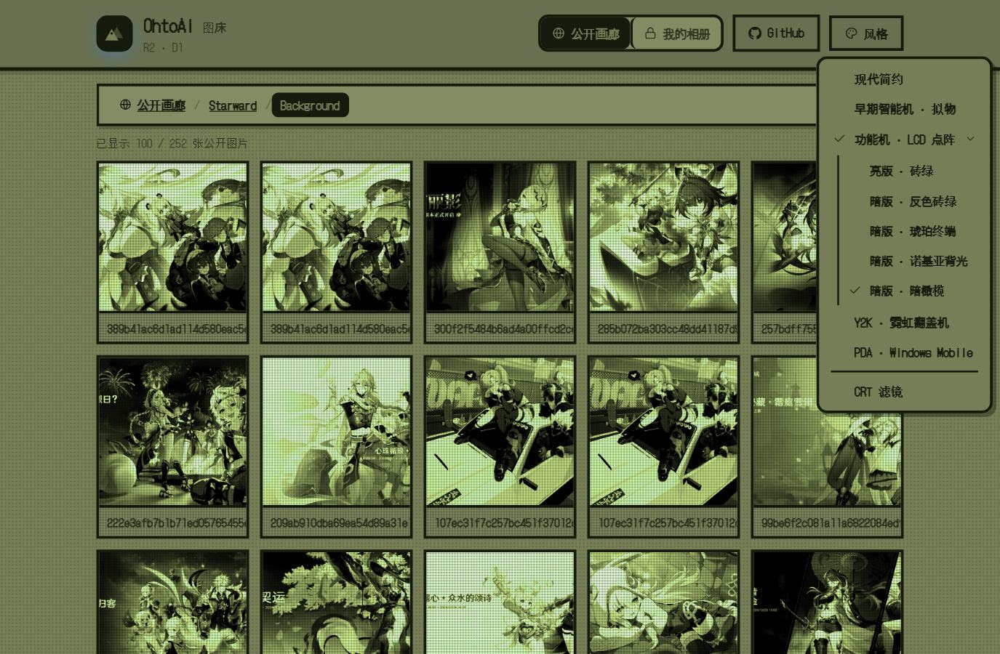
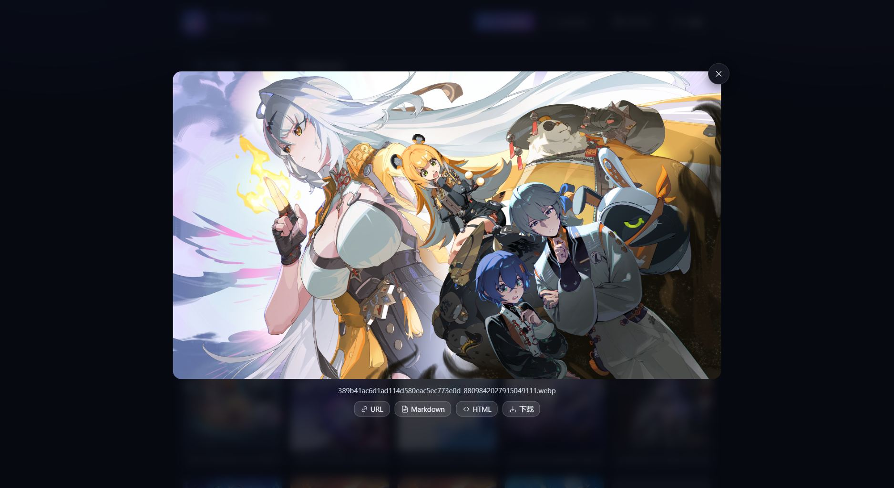
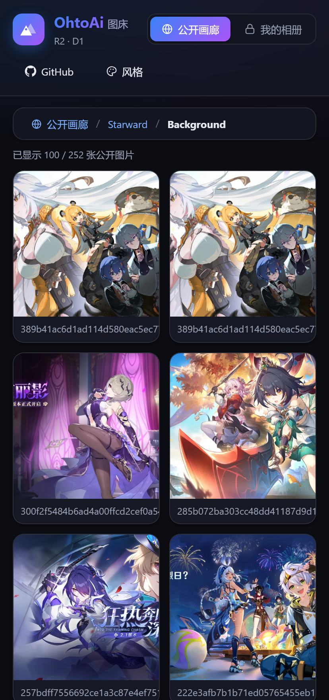

# OhtoAi 图床

[](https://developers.cloudflare.com/r2/)
[](index.html)
[](#界面风格)
[](#成本与安全)
[](https://img.ohtoai.top/)

**图床，但是不（完全）需要服务器后台。** 图片放 Cloudflare **R2**，元数据（分级 / 隐藏 / 相册）放 **D1**，
逻辑跑在 **Worker** 上，前端是一个纯静态单页 —— 没有服务器要运维，也没有一样东西在收费额度之外。
图片出网流量本身免费，所以「图被人看」这件事不产生账单。

页面和图片**从同一个桶、同一个域名发出去**（`index.html` / `config.js` 也放在 R2 里），
所以那些要读字节进度的流式 `fetch` 全是同源请求，整站没有一处 CORS 依赖。

在线实例：**<https://img.ohtoai.top/>**（公开画廊，游客视角）

<p align="center">
  
</p>

## 功能一览

| 功能 | 说明 |
| --- | --- |
| **相册** | 相册是数据库里的一列，不是目录前缀。重命名 / 移动 / 删除都只改数据，**已分享出去的直链永远不会失效** |
| **上传** | 拖拽 / 点击 / `Ctrl+V` 粘贴，支持批量；拖整个文件夹会**递归**扫描并保留目录结构 |
| **缩略图** | 上传时在浏览器里用 canvas 生成（居中正方形 WebP，512×512），相册首屏流量降一到两个数量级 |
| **大图灯箱** | 点开即看，一键复制 URL / Markdown / HTML，或按图片名字存盘 |
| **流式下载** | 自己 fetch 字节，所以网格和灯箱都有**真实百分比进度**；慢网下还能「先糊后清」 |
| **分级与隐藏** | 两个**独立**维度，决定图片是否出现在相册里；直链始终可访问（相册是陈列，不是门禁） |
| **遮罩** | 敏感内容默认糊住、点一下才显示：公开画廊按 R15/R18，「我的图库」按自己设的「隐藏层级」（默认 R15 起，未分类可单独关掉）。糊着的卡片只下 512px 缩略图、不悬停预取，揭开那一下也不下原图 |
| **公开画廊** | 游客视角，按分级档位陈列；相册可以直接把链接分享给别人 |
| **界面风格** | 九套皮肤 + 一个正交的 CRT 滤镜，**访客也能换**（纯外观，不影响数据） |
| **批量整理** | 多选批量删除 / 移动 / 改分级 / 隐藏；粘贴远程图片 URL 直接转存进桶 |
| **成本** | 图片出网 ￥0；Worker、D1、R2、CDN 都在免费额度内（页面与图片同源，不产生任何 Worker 请求） |

## 界面风格

九套皮肤收在顶栏「风格」里，另有 CRT 滤镜可以叠在任意一套之上。下面四张是同一屏内容：

<table>
<tr>
<td width="50%"><br><sub>Y2K · 霓虹翻盖机（默认）</sub></td>
<td width="50%"><br><sub>早期智能机 · 拟物</sub></td>
</tr>
<tr>
<td><br><sub>功能机 LCD · 暗橄榄</sub></td>
<td><br><sub>PDA · Windows Mobile</sub></td>
</tr>
</table>

<p align="center">
  
</p>

| 值 | 外观 |
| --- | --- |
| `lcd-olive` | 功能机 LCD · 暗橄榄：亮版压暗去饱和，不反色 |
| `lcd` | 功能机 LCD · 亮版砖绿：灰绿底 + 网点 |
| `lcd-inv` | 功能机 LCD · 反色砖绿：ink 与 paper 对调，深绿屏 + 发光像素 |
| `lcd-amber` | 功能机 LCD · 琥珀终端 |
| `lcd-backlight` | 功能机 LCD · 诺基亚背光（暗青绿） |
| `skeuo` | 早期智能机拟物：亚麻纹理、高光玻璃按钮、相框式卡片 |
| `y2k` | Y2K 霓虹翻盖机（默认）· 深紫夜空 + 扫描线 + 青粉霓虹 |
| `pda` | PDA / Windows Mobile：银灰窗口 + 3D 倒角 |
| `modern` | 现代简约：原来的设计，带跟随系统的深色档 |

选中的皮肤存在本机 `localStorage`，优先于 `config.js` 里的 `skin`。
皮肤挂在 `<html data-skin>` 上，由 `<head>` 里的一小段内联脚本在首帧前贴好 —— 否则会先按默认皮肤画一遍再跳过去。

<details>
<summary>皮肤的写法与 CRT 滤镜的实现细节</summary>

**加一套新皮肤**：在 `index.html` 的 `/* 复古皮肤 */` 一节里加一段 `html[data-skin="名字"]` 规则，
先重定义设计令牌（`--bg` / `--panel` / `--border` / `--radius` / `--shadow-*` …），再补该皮肤特有的形态规则；
最后把名字加进主脚本的 `SKINS` 数组即可。**令牌是主力** —— 主站大部分组件都拿令牌长的，
换了令牌它们会自己跟上，不必逐个点名。

LCD 一族更进一步：五个变体共用同一套形态规则（选择器统一写 `[data-skin^="lcd"]` 前缀匹配），
区别只在 `--lcd-*` 那几个变量上，所以加一版新配色只要写一个变量块。
注意变量的方向别搞反 —— LCD 里「亮 = 有像素」，抬一档的面永远比纸面亮、沉一档的永远比纸面暗；
反色版是**对调 ink 与 paper 的角色**，不是把整个调色板取反。照片也跟着反色就成负片了
（太阳会变成黑点），所以 `--lcd-photo-filter` 保留照片自己的明暗，只染成屏幕色再压暗。

⚠️ **网格照片的滤镜只能走 `--photo-filter`**：皮肤别自己写 `html[data-skin=…] .grid img { filter: … }`。
那种规则在文件更靠后、特异性又和敏感内容遮罩那条一模一样，会把遮罩的 `blur(38px)` 整个顶掉 ——
症状是「只有这套皮肤下遮罩形同虚设，图看得清清楚楚」，很难往 CSS 上想（LCD 一族踩过）。
往 `--photo-filter` 里放值，遮罩的糊会自动叠在它之上。

**CRT 滤镜**是个独立开关（`config.js` 里的 `crt`）：它在整页之上蒙一层扫描线 + 荫罩 + 四角暗角 +
极轻微的亮度闪烁，外加**镜头畸变**（整屏按球面鼓出来、四角往里收），**和皮肤正交** ——
皮肤决定「这台设备长什么样」，CRT 决定「这块屏好不好」，所以两者能任意组合，
开关状态单存一个键，换皮肤不影响它。

全部落在一个 `position: fixed` 的覆盖层上（`#crtLayer`），`pointer-events: none`，只做光学效果、
不碰任何布局，也不需要皮肤配合。强度是这几个变量，嫌重嫌轻改它们即可：

```css
--crt-scan: .22;      /* 扫描线深度 */
--crt-grille: .045;   /* 荫罩（RGB 细条纹）强度 */
--crt-vignette: .55;  /* 四角压暗（径向） */
--crt-edge: .42;      /* 四条边往里压暗的深度 —— 「管面往边缘卷下去」那一圈 */
--crt-curve: .045;    /* 屏幕形状：黑边的弧度。纯覆盖层，一点命中代价都不花 */
--crt-warp: .045;     /* 画面位移：让画面本身也弯。**这条要花命中代价**，见下面的「已知取舍」 */
--crt-sweep: .22;     /* 滚动扫描亮带的亮度 */
--crt-roll: 6s;       /* 亮带滚一整屏要多久 */
```

两个弧度分开是有意的：屏幕形状（黑边、以及它盖住的那圈）只是画上去的，不影响任何交互；
画面位移会真的把内容和光标错开，所以单独一个旋钮，代价单独算。`--crt-warp: 0` 就是「只要屏幕
形状、不要位移」那一档。

**镜头畸变**挂的是 `backdrop-filter: url(#crtWarp)`，而不是给页面套一层 `filter`：
`backdrop-filter` 只吃背景、不参与布局，页面结构一格都不用动，灯箱/弹窗那些 `fixed` 层
也不会被 `filter` 拽成「相对 body 定位」（那会把它们从视口里甩出去）。
代价是**只有 Chromium 系认这个写法**，Safari / Firefox 解析不了 `backdrop-filter` 里的 `url()`：
`@supports` 会整个拦住，它们拿到的是没弯的平面扫描线 —— 不是坏掉，只是不弯。

位移图是主脚本现画的（一张 R 存 x 位移、G 存 y 位移的 PNG，128 = 不动），因为
`feDisplacementMap` 的 `scale` 只有一个数、横竖共用，而横向位移要按屏宽、纵向按屏高归一化，
差着一个 `h/w`。画图时那一步**钳位**别删：桶形畸变在边缘要往画面外采样，而 Chromium 对出界
的处理是**镜像回绕**（`feDisplacementMap` 的 `edgeMode` 它不认），不钳的话屏顶会冒出一条
上下翻转的顶栏 —— 看着像重影，其实是照镜子。夹回边界内就变成「最边上那行像素被拉长」。

**光栅黑边**（`#crtBezel`）画的就是那片被钳住的区域 —— 采样点被钉在画面边缘，本来就是拉花的，
索性照显像管的样子压黑，四角因此收出圆角。它的边界解的是 `|x|·(1 + k·(x² + y²)) = 1`
（采样点刚好落在画面边缘的等值线），所以和钳位区严丝合缝：黑的正好是该黑的那一圈，
边缘往里一个像素都不多吃。注意这条曲线对 x 和对 y 是**同一个条件**，可见区是一条闭合曲线的内部，
不是四条边各管各的。

> **已知取舍**：画面位移和浏览器的命中检测是两套坐标 —— 效果是画上去的，版式一个像素没动，
> 命中检测也就永远按没弯的算。默认强度下两者相差：画面中间约 5px，顶栏右上角那片 30px 出头，
> 是真会点错。主脚本用两段补偿把它找回来：
>
> - **动作事件**（`click` / `dblclick` / `contextmenu`）：按同一个映射倒推回版式坐标，
>   再补发到那个元素上。这里有个坑别踩：不能因为「原目标是它的父/子节点」就跳过 ——
>   点卡片看得见的边缘时，原始落点在卡片缝隙里（原目标是 `#galleryGrid`），
>   而它恰恰**包含**那张卡片，一放行点击就落空了。
> - **悬停高亮与光标形状**：这两样没有 API 能改（`:hover` 由浏览器按真实指针位置算），
>   所以干脆不用 `:hover` —— 启动时把样式表里带 `:hover` 的规则镜像一份成 `.crt-hover`、
>   把原规则接上 `:not(*)` 废掉，之后按补偿后的位置自己挂类。这站的 `:hover` 选择器形态很干净
>   （没有 `:is()`/`:not()`/`:has()`，也没藏在 `@media` 里），字符串替换是安全的；
>   真遇到复杂的会整段安静退回去，不影响别的。
>
> **还是补不了的**：框选/拖拽跨着一长串 `mousemove`，只补起点会把矩形画歪，不如不补。
> 想彻底没有这层错位，把 `--crt-warp` 调到 0 —— 那时画面是平的，补偿整段歇工，
> 屏幕形状改由 `--crt-curve` 扛（黑边弧度仍在不花命中代价）。

**滚动扫描亮带**（`#crtSweep`）是老显示器帧不同步时那条爬过屏幕的亮带。要点是**它得是弯的**：
屏是球面，扫过去的亮线在屏上就是一截弧。做法不是画条直带子再加圆角 —— 那样只是两头变尖、
整条还是直的 —— 而是拿一个横向圆角半径等于半宽的椭圆：拱高就等于纵向圆角半径，
弧才真的压进可视区。盒子比视口宽出 36%，是为了把收尖的两个端点挪到屏外，
否则尖点正好落在左右边缘上，看着像条两头拉尖的梭子。

这条带子很淡，**别靠翻整页截图判断它有没有生效** —— 整页图会被缩略显示，淡淡的纵向渐变
正好被洗掉（这一轮就是这么误判了两次的）。两个可靠办法：

- 跑本地的截图脚手架（`_site/theme-shot.js`，不入库）：它把亮带定住不动，与「强度 0」的同一行做差，
  打出峰值差与半高宽度。正常应当在亮带中线处得到 +45 上下、半高宽约 35px 的平滑鼓包。
- 或者裁一条 **150px 宽的窄条**（窄图不会被缩放），鼓包一眼可见。

管面感是三样叠出来的，缺一样都会露馅：只做径向暗角的话暗的只有四角、四条边还是平的，
看着像贴了张暗角贴纸；加上一圈边缘内阴影才像玻璃朝观察者鼓出来；反光用椭圆而不是斜条
（斜条是窗玻璃，椭圆高光才是球面管）。

**关于桶形畸变**：这里没有做几何形变，是刻意的。真做需要给页面祖先挂 SVG
`feDisplacementMap`，那会带来两个问题 —— 一是按规范 `filter` 会让元素成为
`position: fixed` 后代的包含块，而灯箱 / toast / 右键菜单 / 上传悬浮球全是 fixed，
它们会退化成跟着页面滚走；二是它会把照片本身掰弯（大图刚改成不偏色，再掰弯就矛盾了），
而且整页每帧都要重新栅格化，图多的相册滚动会明显变卡。

闪烁刻意压得很小：一是有光敏风险（WCAG 2.3.1 卡在每秒 3 次，这里约 5.5 秒一次），
二是幅度一大看久了累；`prefers-reduced-motion` 下会整个停掉。

</details>

## 大图（灯箱）

<p align="center">
  
</p>

- 原图走和卡片同一套流式下载，进度条画在信息区；关掉灯箱就掐掉在途请求 —— 几 MB 的东西，
  用户已经不想看了就别接着下
- **那一格一打开就按原图尺寸占好了位**，所以整张图落下来时不会把灯箱重新布局一次。
  尺寸不必等整张图：首块字节里的文件头（JPEG 的 SOF、PNG 的 IHDR）一被解析就够了，
  而首块本来就要读。量到的尺寸按图片键记着，鼠标在卡片上停够（悬停预取）或看过一次，
  下次点开是零等待
- 量不出尺寸就退回改造前的行为（图到了才撑开）：格式解不开，或文件头被超长的 EXIF / ICC
  顶到了首块之外

## 手机

窄屏不做另一套页面：同一份 HTML 靠 CSS 重排 —— 顶栏折成两行，网格退到两列，灯箱照常。

<table>
<tr>
<td width="300"></td>
<td>

- 上传走的是系统文件选择器（`<input type="file" multiple>`），手机上就是相册 / 相机那一套界面
- 卡片菜单绑的是 `contextmenu` 事件，手机上**长按即出**，和桌面右键是同一份菜单
- 皮肤与 CRT 开关存在本机浏览器里，手机打开是它自己的那一份，不会把桌面上的选择带过去
- 触屏没有 hover，所以「悬停预取原图」不会触发：点开大图时才开始下载（进度条照旧）

</td>
</tr>
</table>

## 架构

```
       浏览器
         │  ① 管理接口（上传 / 列表 / 改分级 / 缩略图…）
         ▼
  ┌───────────────────┐        ┌────────────────┐
  │ Worker  picbed-r2  │──────▶ │  D1   images    │  分级、隐藏、相册、缩略图键
  │ picbed-worker.     │        └────────────────┘
  │    ohtoai.top      │
  └───────────────────┘
         │ ② 写
         ▼
  ┌───────────────────┐
  │  R2  picbed-images │◀──── ③ 页面与图片（绝大多数请求）
  └───────────────────┘       img.ohtoai.top
         ▲                    ├ /index.html /config.js → 站点本身
         │                    └ /img/…                 → 图片
    访客看图 / 打开站点          走 Cloudflare 边缘缓存，**不经过 Worker**，
                              也不计 Worker 请求数；R2 出网流量本身免费
```

站点那两个文件由 CI 传进同一个桶（`push` → 工作流 → 桶，见「部署一套自己的」），
所以图和页面是**同一个源**。`picbed.ohtoai.top` 与 `album.ohtoai.top` 只是别名：
一条 Redirect 规则把两者 301 到 `img.ohtoai.top`（所以旧链接照旧能开）。

几个刻意的设计：

- **图片字节不经过 Worker**。直链由 R2 桶的自定义域名直接提供，Worker 只管元数据和上传。
  站点文件（就 `index.html` 与 `config.js` 两个）也放在同一个桶里，于是「页面」与「图片」
  同源，且**这条路上一个 Worker 请求都不花** —— 换成用 Worker 统一路由的话，每张图都是一次
  Worker 调用（一页最多 100 张），免费额度那条每天 10 万请求的线很快就会碰到。
- **`is_hidden` 和 `rating` 只影响「相册里列不列」，不拦直链**。任何状态的图，拿到直链都能打开 ——
  相册是「陈列」，不是「门禁」。想给直链加门禁的话，见 `worker-r2/src/access.js` 末尾的扩展位说明。
- **两种不可见是独立的**：`is_hidden=1`（主动隐藏）和 `rating='unspecified'`（未分类）都会让图不进相册，
  但原因不同，后台用不同徽标区分。
- **键不可变**：每次上传都生成新键，相册名不参与其中。所以移动/重命名相册只改一列数据，
  已分享出去的链接永远不会失效。

## 部署一套自己的

前端是静态页，后端是 Worker + R2 + D1 —— 整套都能开在自己的 Cloudflare 账号下，仍在免费额度内。

```bash
cd worker-r2
npx wrangler login

npx wrangler d1 create picbed-db            # 建库，把 database_id 填进 wrangler.toml
npx wrangler d1 execute picbed-db --remote --file=schema.sql
npx wrangler r2 bucket create picbed-images --location apac   # 建桶（位置建完不能改）
npx wrangler r2 bucket cors set picbed-images --file=r2-cors.json
npx wrangler secret put PICBED_PASSWORD     # 不设的话管理接口一律 503（故意 fail closed）
npx wrangler deploy
```

然后改 `config.js` 里的三个地址（Worker 地址、唯一域名、仓库地址），把仓库推到 GitHub。
**站点自己也从 R2 桶发出去**（就 `index.html` 与 `config.js` 两个文件，CSS/JS 全内联），
于是页面与图片同源，那些要读字节进度的 fetch 不依赖 CORS：

- 仓库 → Settings → Secrets and variables → Actions 加一个 `CF_API_TOKEN`
  （权限只给 **Account · Workers R2 Storage · Edit**），再把 Account ID 填进
  `worker-r2/wrangler.toml` —— 之后每次 push 由 `.github/workflows/deploy.yml` 把两个文件传进桶
- 控制台里还有几件 wrangler 建不了的事：给 R2 桶绑自定义域名、别开 `r2.dev` 测试域名、
  加一条免费的 URL Rewrite 规则把 `/` 内部改写到 `/index.html`（桶不做目录默认页；
  是改写不是跳转，地址栏不变）

**完整步骤（含别名域名怎么 301 过来、缓存规则怎么设）、接口说明、配置项、以及
「以后给已有的库加列/加索引」都在 [`worker-r2/README.md`](worker-r2/README.md)。**

## 目录结构

```
picbed/
├─ index.html              # 前端页面（上传 / 相册 / 公开画廊，纯静态单页）
├─ config.js               # 站点配置（后端地址、唯一域名、仓库地址、默认界面风格）
├─ .github/workflows/      # deploy.yml：把上面两个文件传进 R2 桶（站点就是从桶里发出去的）
├─ docs/preview/           # README 里的预览图
├─ worker-r2/              # 后端：Worker + R2 + D1
│  ├─ src/
│  │  ├─ index.js          #   入口与路由
│  │  ├─ access.js         #   相册可见性判定（分级参数的唯一解释处）
│  │  ├─ api.js            #   上传 / 列表 / 改分级 / 缩略图 / 相册操作 / 转存
│  │  ├─ db.js             #   D1 读写
│  │  └─ admin.html        #   后端自带的精简管理页（应急 + 批量操作用）
│  ├─ schema.sql           #   建表
│  └─ README.md            #   ★ 部署步骤、接口说明、配置项
```

## 使用说明

页面顶部两个标签：**公开画廊**（游客视角）与**我的图库**（管理视角，就是你自己那本账）。
本机存过密码的话，打开会直接进管理视图；没密码时点「我的图库」会引导你去设置里填。
存的是密码本身而不是会话，所以换台设备要重填一次 —— 后端只认一个共享密码，没有账号体系。

### 分级与隐藏

每张图有两个独立的状态：

| | 取值 | 说明 |
| --- | --- | --- |
| `rating` | `G` / `R12` / `R15` / `R18` / `unspecified` | `unspecified` = 未分类，**不进任何相册**（等于旧版的「未公开」） |
| `is_hidden` | 0 / 1 | 主动隐藏，不进任何相册 |

在管理视图里点图片卡片右下角的图标切换隐藏、改分级走右键菜单或灯箱。

**两者都不影响直链** —— 隐藏的图，拿到 URL 的人照样能打开。

### 公开画廊的档位

访客默认只看到 **G**。想放宽范围，在地址后面加参数（页面上故意不放控件）：

| 参数 | 陈列的分级 |
| --- | --- |
| （无） | G |
| `?rating=r12` | G, R12 |
| `?rating=r15` | G, R12, R15 |
| `?rating=r18` | G, R12, R15, R18 |
| `?rating=r15_only` | **仅 R15**（`_only` 不累进） |

**R15 / R18 默认是糊住的**（类似 Twitter 的做法）：即使 `?rating=` 把它们列了出来，卡片上也是一层遮罩，
**遮罩上标着是哪一档**（R15 / R18，配色跟文件名前那个分级徽标同一套），点一下才显示 ——
遮罩底下的卡片**只下 512px 的缩略图**（糊得只剩个轮廓），连悬停预取都关着，
所以「鼠标顺路扫过」不会把敏感原图拉下来。揭开那一下也不下原图（网格里摆的本来就是缩略图），
原图要么等你**点进灯箱**，要么等揭开之后鼠标在那张上多停一会儿 —— 那时才算你说了要看。
想整体放开，再加一个安静参数：`?reveal=1`。

`rating` 和 `reveal` 是两件事：前者决定「列不列出来」，后者决定「糊不糊」。

### 「当前目录」是地址栏里的 `?album=`

点进任意相册，地址栏里都会带上 `?album=<相册名>`（如 `?album=旅行/2024`），
**把这个网址复制给别人，对方打开就直接进那个相册**。浏览器的前进/后退键也能在相册之间走。

这条路径**对两个标签都生效**：在「我的图库」里翻到哪个相册，切到「公开画廊」还是那个相册
（反过来也一样），刷新、深链、前进后退都在原处 —— 同一棵目录树的两个视角罢了，
没必要各记一份「我在哪」。差别的只是过滤：公开画廊只列出可陈列的图与相册，
所以从「我的图库」切过去时，某个相册可能显示成「还没有可看的图片」，那是它真的没有可陈列的。

右键相册卡片 →「复制相册链接」即可。分享链接里**不会**带上 `reveal` ——
要不要显示敏感内容由打开的人自己决定。

### 我的图库：隐藏层级

管理视图里也有自己的一道遮罩，在**设置**面板里（只在「我的图库」显示）：
**默认 `R15`** —— R15 及以上的图片在管理视图里默认糊住，点一下才显示，
投屏、有人站在背后时整理相册用。想全放开就选「关闭」。

下面还有一个**「未分类的也一并糊住」**，默认勾着：未分类的图还没被过过目，跟公开画廊
「未分类不进相册」是同一种保守 —— 不然刚传完、还没分级的图就都在屏幕上明摆着。
嫌它碍事（比如正要一张张过一遍再分级）可以取消勾选，那时只有标了档位的会被糊。
选「关闭」时这一项不生效（界面上会灰掉）。

遮罩上会标出是哪一档盖住的（`R12` / `R15` / `R18`，未分类写作 `U`）——
省得为了看一眼档位先揭开它。

被糊住的卡片同样**只下 512px 缩略图**、悬停预取照旧关着，「多选」模式下点它只是选中、
不会顺手揭开；右键「查看大图」这类明说要看大图的操作不受它限制。它只是自己屏幕上的遮罩，
**直链与数据都不受影响**。

### 上传

- 拖拽 / 点击 / Ctrl+V 粘贴，支持批量；拖整个文件夹会**递归**扫描并保留目录结构
  （`A/2024/x.jpg` → 相册 `A/2024`，子文件夹层层照搬，多深都行；最外层那个文件夹名也算一层）
- 上传前可在面板里选**默认分级**（默认 `unspecified`，即传完不进相册，要手动设过才公开）
- 上传时会自动生成缩略图（居中正方形 WebP，512×512）；生成失败不影响原图，网格会退回原图
- 单张上限 50MB

### 缩略图

- **在上传时由浏览器生成**，作为独立对象存进 R2。不是给原图加查询参数
  （R2 会忽略未知查询参数、返回原图，那样「缩略图取不到就退回原图」的逻辑永远不会触发）
- 卡片在下载时会显示百分比进度；缩略图**没有渐进显形**（那是服务端编码能力，
  canvas 生成的是基线 WebP），原图的渐进显形取决于原文件本身
- 旧的存量图可以用工具栏的 **「补缩略图」** 批量补：浏览器里逐张拉原图 → 生成 → 上传，
  可随时刷新中断，下次接着补

### 相册

- 相册 = 数据库里的一列，形如 `2026/10/03` 或 `旅行`（可以用 `/` 分层）
- **新建相册**：往目标相册传第一张图，相册就存在了。「新建相册」按钮的作用是先带你进入那个相册
- **重命名**和**移动**是两个入口：重命名只改这一层的名字，移动只换父级、名字不变
  （从前合成一个「新的位置（含相册名）」的输入框，改个名字也得先看懂整条路径）。
  两者都是整棵子树一条 SQL 搞定，不搬 R2 里的文件，**图片直链不变**
- 移动时的相册树会**自动展开到你当前所在的那一层**并标出「当前位置」，不用一层层点开；
  顶上还有一行「全部（根目录）」可直接选
- **删除相册**：会递归删掉子相册和里面所有图片（确认框会写明数量和体积），不可恢复

### 图片的名字

右键卡片 →「重命名」，或点开图片后用灯箱里的「重命名」改的是**这张图的名字**，
它有三个用处：卡片与灯箱的标题、复制 Markdown / HTML 时的 `alt`、以及下载存盘的文件名。

- **不影响直链**：键（URL 里的 `2026/10/03/164503_e72bf439.jpg` 那一段）是不可变的，
  改名字属于纯元数据改动，之前分享出去的链接照样有效
- 想让存盘的文件就叫这个名字，用**下载**按钮（灯箱里和卡片右键菜单里都有）：它把字节取回来再存，文件名由前端指定。
  右键「图片另存为」做不到这件事 —— 那个名字由浏览器按 URL 决定，服务端影响不了
  （`Content-Disposition: inline; filename=` 不被另存为采纳，而 `attachment` 会强制下载、
  图片就没法内嵌显示了，对图床是自毁）
- 存盘名会净化一层：显示名里的 Windows 非法字符（`"` `<` `>` `|` 等）换成 `_`；
  显示名没写扩展名时，自动补上真实的扩展名（如 `.jpg`）

### 管理

- 上传面板：右下角悬浮按钮，含进行中的队列、本次结果、上传历史（仅存本机浏览器）
- 多选模式：批量删除、批量移动、批量改分级、批量隐藏
- 复制链接：URL / Markdown / HTML 三种格式（Markdown 与 HTML 的 `alt` 用图片的名字）
- 下载：灯箱里的按钮或卡片右键菜单，存盘文件名用图片的名字（详见上面的「图片的名字」）
- 转存：粘贴远程图片 URL，由 Worker 抓取后存进 R2（大小上限与上传相同，15 秒超时）
- 直链卡片显示的是 `blob:` 地址属正常 —— 那是流式下载器把图片读进内存后的临时引用，
  要分享请用卡片上的复制按钮

### 后端自带的精简管理页

`https://picbed-worker.ohtoai.top/admin` —— 一个平铺表格，按条件筛选 + 批量改分级/隐藏/删除。
它跟后端同源、不依赖前端和 R2 的 CORS 配置，所以**前端出问题时它是应急通道**。
日常传图和整理相册请用站点。

## 常见问题

| 问题 | 原因 / 解决 |
| --- | --- |
| 管理接口报 503 | 服务端没设 `PICBED_PASSWORD`（故意 fail closed） |
| 上传的图不出现在相册里 | 默认分级是 `unspecified`（不进相册），去改成分级即可 |
| 隐藏了图片但直链还能打开 | **这是设计如此** —— 隐藏只影响相册陈列 |
| 缩略图 404 了一下又正常显示 | 那张图还没补缩略图，前端自动退回原图。点「补缩略图」 |
| 相册里图片加载慢 | 同上：没有缩略图时下载的是原图 |
| 上传报 CORS 错 | 检查 Worker 的 `ALLOWED_ORIGINS` 是否包含站点域名 |
| 老链接打不开 | `album.ohtoai.top`、`picbed.ohtoai.top` 现在都 301 到唯一域名 `img.ohtoai.top`，键名与迁移前一致 —— 跟着跳转就行 |
| 换了域名之后，我这边存的密码与设置不见了 | `localStorage` 按 origin 隔离，换域名等于换了一个站。重填一次即可（访客不受影响） |
| 自己部署时打开根路径 404 | 桶不做目录默认页：加那条 URL Rewrite 规则（`/` → `/index.html`） |
| `wrangler … --local` 跑完不回命令行 | wrangler 在 Windows 上回收 workerd 有问题；SQL 已执行完，Ctrl+C 即可 |
| 用 `wrangler r2 object put` 传了对象，直链却 404 | 该子命令**默认写本地模拟桶**，要加 `--remote` |

## 成本与安全

- **成本**：图片出网流量 **0 元**（R2 出网免费，这是迁移最大的收益 —— 之前 COS 是 0.5 元/GB）。
  存储 644MB 落在 R2 免费额度（10GB）内。Worker / D1 / R2 / CDN 都在免费额度内。
- **密钥**：Worker 侧只有 `PICBED_PASSWORD`（管理接口的共享密码，`wrangler secret`）；
  CI 用一把 `CF_API_TOKEN`（权限只给 Account · Workers R2 Storage · Edit，负责把站点文件传进桶），
  Account ID 明文写在 `wrangler.toml` 里 —— 它不是密钥，知道它也访问不了任何资源。
  迁移时那把 rclone token 已可作废。
- **直链是公开的**：图片域名谁拿到 URL 都能打开，隐藏和分级只管相册陈列。
  介意的话给 R2 桶开防盗链，或把敏感图放别的桶。
- **管理接口的跨域**：只有 `ALLOWED_ORIGINS` 里列出的来源能拿到 CORS 头，且不带 credentials。

## 迁移历史

### 2026-10：收敛成一个域名，站点也搬进桶

原先站点在 GitHub Pages（`picbed.ohtoai.top`）、图片在 R2 桶的自定义域名（`img.ohtoai.top`），
两个来源 → 前端那些要读字节进度的 `fetch` 必须跨域。而 R2 只在请求带 `Origin` 时才回
`Access-Control-Allow-Origin` 与 `Vary: Origin`，不带 Origin 的那份边缘缓存副本两个头都没有，
「没有 Vary」又对任何请求都算命中 —— 于是偶尔会读到那份没有 ACAO 的副本，表现为**偶发 CORS
报错、刷新又好了**。

现在站点那两个文件就放在桶的根上，页面与图片同源，这一整类问题在结构上消失；部署从
GitHub Pages 换成工作流传桶（Pages 那份留作镜像）。`picbed.ohtoai.top` 与 `album.ohtoai.top`
退成别名，301 到唯一域名 —— 旧链接照旧能开。CF 账单没变：图片仍由桶直出、仍走边缘缓存，
**这条路上一个 Worker 请求都不花**。

### 更早：从腾讯云 COS 搬到 Cloudflare

本站原先跑在腾讯云 COS 上（图片直连 COS 自定义域名，Worker 只负责签临时密钥，
「公开」靠零字节标记对象实现）。后来整体迁到 Cloudflare R2 + D1：

- 326 张存量图片已搬到 R2，键名保持不变，**旧链接依然有效**（那两个域名如今 301 到唯一域名）
- 公开标记被 D1 里的 `rating` 取代；相册从「目录前缀」变成数据库里的一列
- 迁移脚本、种子 SQL、迁移手册都是**一次性**的，用完已经从仓库里清掉了（需要时翻 git 历史）
- 腾讯云那边的资源（COS 桶、子账号密钥）**尚未删除**，作为冷备份保留
